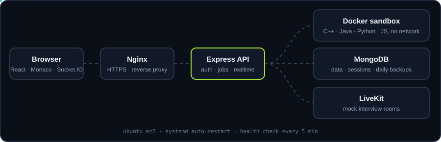
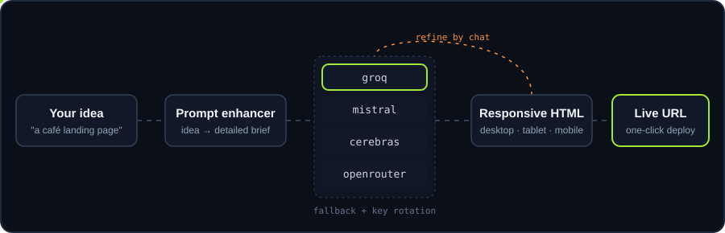

  
  
  
  

  

## 🚢 Things I've shipped

### CodeVerse: interview prep that runs in production
<a href="https://interviewlattice.duckdns.org/"><b>Live ↗</b></a> · <a href="https://github.com/mradul-08/interview_platform"><b>Code</b></a>

One place to prepare for interviews: DSA practice with real code execution, aptitude tests, mock interviews, study groups and chat. I built it end to end and run it on my own server.

<b>What's inside</b>

- Submitted code runs in short-lived Docker containers with **no network access** and a read-only filesystem (C++, Java, Python, JavaScript)
- Problems with test cases, verdicts, discussions, bookmarks and sheets
- Timed aptitude tests with analytics, streaks and badges
- Mock interviews in LiveKit rooms, study groups with leaderboards, direct messages and notifications
- Production on Ubuntu EC2: Nginx for HTTPS, systemd restarts, a health check every 5 minutes, and daily MongoDB backups kept for 14 days

`React 19` `Vite` `Express 5` `MongoDB` `Socket.IO` `Passport` `BullMQ` `Docker` `Nginx` `AWS EC2`

---

### GenWeb.ai: describe a website, get a live website
<a href="https://genweb-ai-delta.vercel.app/"><b>Live ↗</b></a> · <a href="https://github.com/mradul-08/Genweb.ai"><b>Code</b></a>

Type an idea in plain words and get a complete responsive website. Keep chatting to change it ("add a dark mode toggle"), then deploy it to a public URL in one click.

<b>What's inside</b>

- If one AI provider is down or rate-limited, the next one takes over, with key rotation and availability tracking
- Edits by chat change only the part you asked for and keep the rest of the design
- Source view with direct editing, undo and redo, and desktop, tablet and mobile previews
- Dashboard with search, thumbnails and deployment status; redeploy or take a site offline
- Google sign-in through Firebase, JWT cookie sessions, and Razorpay credit purchases with signature checks

`React` `Vite` `Framer Motion` `Node.js` `Express` `MongoDB` `Firebase` `Razorpay`

---

<table>
  <tr>
    <td width="50%" valign="top">
      <h3>📨 LinkedIn Smart Messenger</h3>
      <a href="https://github.com/mradul-08/linkedin-smart-messenger"><b>Code</b></a> · v4.2.0
      
A Chrome extension for personal LinkedIn outreach. It has its own search language (<code>company:google -intern</code>), typo-tolerant people search, an inbox reply system, schedules, follow-ups and AI drafts. It never sends anything until you press Yes, and it keeps to daily limits.

      <code>Manifest V3</code> <code>JavaScript</code> <code>Claude API</code> <code>Playwright</code>
    </td>
    <td width="50%" valign="top">
      <h3>🎨 Portfolio</h3>
      <a href="https://my-portfolio-nu-mauve-3hwthnyqyz.vercel.app/"><b>Live ↗</b></a> · <a href="https://github.com/mradul-08/MY-PORTFOLIO"><b>Code</b></a>
      
My animated portfolio. It has a contact form and a password-protected admin area where I upload new resume versions to Vercel Blob, so the live resume changes without a redeploy.

      <code>Next.js</code> <code>TypeScript</code> <code>GSAP</code> <code>Framer Motion</code>
    </td>
  </tr>
</table>

## 🧰 Toolbox

| I write | I build with | I ship with |
|:-:|:-:|:-:|
|  |  |  |

**LLMs I plug in:** `Groq` · `Mistral` · `Cerebras` · `SambaNova` · `OpenRouter` · `Cloudflare Workers AI` · `Claude`

## 📈 Activity

  
  

<picture>
  <source media="(prefers-color-scheme: dark)" srcset="https://raw.githubusercontent.com/mradul-08/mradul-08/output/snake-dark.svg"/>
  
</picture>

<code>$ exit</code> · thanks for stopping by. I'm open to SDE internships, freelance work and full-time roles: <a href="mailto:mradulgarg2005@gmail.com">say hi</a>.

